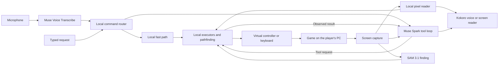

# Player Two

An AI co-op partner for blind, low-vision and motor-impaired gamers: it reads the screen,
answers questions and presses the buttons when you ask.

> **VIDEO PLACEHOLDER: final 3 minute demo goes here before submission.**

For players who want help reading a menu, finding a doorway or taking a turn in a
commercial game. Ask a question or delegate an action; Player Two reads the game window,
answers aloud, sends controller or keyboard input, and checks what changed.
Chrono Trigger has the deepest support. Monster Hunter Stories 3 uses a game-specific
battle routine. Red Dead Redemption demonstrates reading, answering and keyboard input.

## How it works



**Muse picks the tool for requests that reach the agent. Code finds the path and plays the
turns.** Plain requests go straight from a local router to code, without the agent: "where's
the door?" goes to SAM 3.1, with Muse Spark looking alongside in case SAM misses, and supported
Chrono Trigger commands to an executor. Its default fight routine
chooses attacks, healing and revives with local rules; Muse does not choose those turns.
Kokoro runs locally. The Meta models use hosted APIs. Details and limits are below.

## Live results

Chrono Trigger on Steam, Nov 2, build `9c7c6f3`, Battle Mode set to Wait. Each run restarted the
game and loaded the same save, with requests typed into the running app. "Done" means the task
finished correctly, checked against the game's screen. Separately, 63 of 63 synthetic spoken lines
matched the typed parser's decisions in the same game and screen context.

| Request | Done | Whole task |
|---|---:|---|
| Where am I? | 6/6 | 1.0 s |
| What's on the screen? | 6/6 | 21 to 28 s, first words about 1 s |
| Take me to the fair | 6/6 | 3.8 to 4.3 s, a door press from the world map |
| Buy three potions | 6/6 | 17.3 to 20.4 s |
| Take me back outside | 6/6 | 8.5 to 14.9 s |
| Crono, use Cyclone | 4/5 | 6.1 to 8.5 s across all attempts, including the failure |
| Win this fight for me, after a combo took two or three of the party to 1 HP | 4/5 | Wins 42 to 53 s |

In the one lost fight the party was wiped out right after Cyclone was picked. Player Two then went
back through the title and loaded the last save without being asked. A small sample on one save.
[Test notes](docs/validation.md#notes-on-the-live-results) have the details.

## Try it

A fresh install includes the generic narrator and agent, plus the Chrono Trigger pixel reader.

### Requirements

- Windows 10/11 or Linux; Python 3.12 is selected by the installer.
- A Meta Model API key with billing from [dev.meta.ai](https://dev.meta.ai) for live narration,
  questions and speech recognition. Open-weight mode also needs its provider's credentials.
- A supported capture session: Windows windowed/borderless, Linux Hyprland, or X11.
  GNOME/KDE Wayland capture is unsupported. X11 captures the first screen, not just the game.
- Microphone for voice commands, audio output or a supported screen reader. GPU optional.
- Linux: git, [uv](https://docs.astral.sh/uv/), C compiler, Linux kernel headers (evdev),
  PortAudio and gdbus. The Ubuntu commands below install them.
- Windows: PowerShell and internet access. Git is needed only for the source-clone/offline
  checks below, not for the installer or saved-frame narration.

### Linux

On Ubuntu, install the prerequisites and uv first:

```bash
sudo apt update
sudo apt install git build-essential linux-headers-generic libportaudio2 libglib2.0-bin curl
curl -LsSf https://astral.sh/uv/install.sh | sh
export PATH="$HOME/.local/bin:$PATH"
```

Then install Player Two:

```bash
git clone https://github.com/btsouth/player-two && cd player-two
uv tool install --python 3.12 . --excludes uv-excludes.txt
# If player-two is not found: run uv tool update-shell, then reopen the terminal.
player-two --help
player-two setup
```

Setup asks for the key, speech output, microphone, controller, hands-free/talk key and launcher.
It can explain missing devices on a headless machine, but a complete live session needs a desktop.
The controller permission step may request sudo; logging out and back in may be needed.
With NVIDIA, use `".[cuda]"` instead of `.` to install the additional GPU dependencies.

### Windows

Paste into PowerShell:

```powershell
irm https://raw.githubusercontent.com/btsouth/player-two/main/install.ps1 | iex
```

The script installs uv, Python 3.12, the Windows extras, the Visual C++ runtime and, on x64,
ViGEmBus with one elevation prompt, then starts setup. It downloads **main**, so branch-only
fixes are not installed until merged. ViGEmBus is retired; if unavailable, keyboard control
is the fallback. ARM uses keyboard control. Use a windowed or borderless game.
After setup, `player-two --help` lists the commands. A fresh application install on a Windows 11
laptop from public main `259ca29` completed, including setup, help, an offline check and a real
saved-frame Muse response on Nov 2.
The deep Chrono Trigger path has been measured on Linux.

If a valid key/model returns HTTP 404 on a cloud network, see the
[IPv4/IPv6 validation caveat](docs/validation.md#a-real-call-without-a-game). The tested Ubuntu
VM needed an IPv4-only connection for Muse; the Windows laptop did not. Installation and offline
checks do not detect that API routing problem.

### No key or no desktop? Run the offline checks

From the Linux clone used above, run the command below. On Windows, the installer does not
include a source checkout: install [Git](https://git-scm.com/downloads/win), open a new PowerShell,
and first run `git clone https://github.com/btsouth/player-two; cd player-two`.

```bash
uv run --python 3.12 python scripts/self_check.py
```

This loads the packaged reader assets, processes a blank frame, and routes around a wall
with the real A* planner. No network calls, audio, controller or desktop are opened. It is
an install smoke check, **not an AI gameplay demo**. The first `uv run` may install the project dependencies; the check itself makes no network calls.

### No game installed? Describe a practice frame

With a Meta key saved by `player-two setup`, this makes one real Muse Spark request and prints
the answer. It needs no game, microphone, controller, voice playback or desktop. The image is
an original static practice screen, not gameplay. It checks vision narration, not the tool loop
or button presses.

From the Linux source clone:

```bash
player-two narrate --brain meta --game "Player Two practice arena" tests/arena/sample.png
```

On Windows, from any writable folder in PowerShell:

```powershell
Invoke-WebRequest https://raw.githubusercontent.com/btsouth/player-two/main/tests/arena/sample.png -OutFile sample.png -UseBasicParsing
player-two narrate --brain meta --game "Player Two practice arena" sample.png
```

Expect a short description mentioning your turn and Attack being selected; wording varies.
The command prints measured request time and an estimated API cost. It is a paid API call.
Without a key, use the offline check above; there is no no-key AI demo.

For interactive synthetic scenes on a supported desktop, open `tests/arena/index.html` or
`tests/town/index.html` from a source clone in a browser. They can be played manually without a
key. The arena uses up/down, Enter and Escape. To try Player Two with a key, launch:

```bash
player-two run --controls keyboard --window Arena --game "a small JRPG test scene" --companion off
```

Focus the browser, then use the configured talk key or hands-free mode to ask it to read the
screen or attack. Browser capture, focus and keyboard delivery still depend on the desktop;
these scenes are development fixtures, not a cross-platform acceptance test. Automated trials
in `scripts/arena_trials.sh` and `scripts/town_trials.sh` need an isolated desktop and extra tools.

### Play

Start your game, run `player-two`, hold F8 and speak. Setup binds the talk key on Hyprland and
Windows; elsewhere bind `player-two ctl talk` (toggle) or use hands-free. A headset reduces echo.
With the talk key, say “stop” to cancel. Hands-free, say “Player Two, stop”. An unaddressed
“stop” is ignored to avoid cancellations from game speech. Back up saves before allowing actions.
Screen-reader output supports Orca,
speech-dispatcher and NVDA; JAWS is implemented but untested.

## How Meta models are used

| Model | Exact role and implementation |
|---|---|
| Muse Spark 1.3 | Scene narration streams to speech (`narrator.py`, `muse.py`); tool-calling plans in `agent.py`; visual grounding and fallback reads. Offline tools label maps/rooms and build walkthrough steps. The default Chrono Trigger fight loop uses local rules, not model-selected turns. |
| Muse Voice Transcribe | Live speech-to-text in `listen.py`, with game keywords. It is not the speaking voice. |
| SAM 3.1 | “Where is it?” (boxes, spoken and panned) and walking target refinement (`locate.py`, `walk.py`), where no match falls back to Spark. For open questions (“what's around me?”), Muse Spark's `find` tool has SAM outline up to five kinds of thing on one frame; the pixel masks are decoded with Meta's `meta-sam-parser`, measured for position and share of the screen, and written beside the session log. Spark answers from those numbers and the picture; they don't say how far away anything is, so neither does it. SAM is not used for each press. |
| Muse Spark Open | `brain = "open"` switches narration and tool calls to a hosted OpenAI-compatible provider. A saved-frame narration on Baseten returned the visible result text in 6.0 s on Nov 1; this is not a new live agent benchmark. SAM and transcription remain on Meta's API. |

The voice is [Kokoro](https://github.com/hexgrad/kokoro), running locally. Silero VAD detects
speech. Open weights are hosted, not running on the player's PC. Baseten's published rates are
$1.25/M input, $0.15/M cached input and $4.25/M output tokens
([provider](https://www.baseten.co/library/muse-spark-open/)); the saved-frame call used
2,401 input and 294 output tokens, approximately $0.0043 before credits. This is an estimate,
not an invoice.

## Interesting engineering

- **Pixel reader:** Chrono Trigger's font, cursor, turn and HP are read locally (`glyphread.py`,
  `ctsteam.py`, `ctscreen.py`). Ambiguous screens go to Spark. It is a per-game reader, not universal OCR.
- **Atlas navigation:** survey once, locate the view by image matching, route with A*, then check
  position as the character moves (`atlas.py`, `rooms.py`). Emulator RAM is survey/test ground truth;
  live Steam navigation uses pixels, not RAM. Private atlas images are not shipped.
- **Who decides:** common supported Chrono Trigger commands go straight to local executors
  (`fast.py`), with no model planning turn. “Win this fight” uses local attack/heal/revive rules:
  `battle.py` defaults `model_decides=False` and `agent.py` supplies no model decision callback.
  An optional model-decision path exists but is off by default. Muse handles scenes and
  open-ended requests through the tool loop; do not attribute default fight choices to it.
- **Checks after actions:** battle, shop and menu executors check highlights and before/after
  values. Generic press sequences force a new look before a confirm after another button.
  This is evidence checking, not a guarantee that every arbitrary action succeeds.
- **Game speech hold:** Linux game-audio VAD holds narration during detected speech
  (`gameaudio.py`). It has recorded-audio tests and one live Red Dead cutscene with no Player Two line.
  It is not available on Windows, and detection can miss speech.

[Implementation walkthrough](docs/how-it-works.md) explains the tools and failure handling.

## Limits and player control

The navigation and shop results above use private maps and game packs, which contain game art and
can't ship here, so they don't reproduce from a fresh clone. See [game data](#game-data).

The strongest action support is Chrono Trigger in Wait mode. Deep support costs per-game work.
Generic descriptions and tools can fail on other games; action games and autonomous 3D traversal
are not supported. Moving the game between monitors can break image scale matching.

No blind or motor-impaired player has tested it yet. Safety prompts for
saving, loading and story choices are model instructions, not an enforced transaction boundary.
Single-player only: virtual input can conflict with online anti-cheat. Screen frames and speech
are sent to model providers; local notes and event logs may contain game text or your requests.

## What you can say

In Chrono Trigger on Steam, see the measured results above. The generic interface offers
these commands, with behavior dependent on the game:

| Say | What happens |
|---|---|
| a question or request about the game | Player Two attempts to answer or act using the available tools |
| "Player Two, ..." (hands-free) | the same without pressing the talk key; an API key is still needed |
| "what's on the screen?" / "look around" | a spoken tour: what it's like, who and what is around you, the ways out |
| "what does it look like?" / "what's the mood?" | a few sentences on the setting, light, colours and mood |
| "where is the door?" | where it is from your character, with a short sound from that side |
| "take me to the stairs" / "go talk to her" | attempts to walk there in supported 2D scenes |
| "next" | presses A and reads the next line; the Chrono Trigger reader can do this locally, other screens need the model |
| "repeat" | says the last line again |
| "stop" / "cancel that" (hands-free: start with "Player Two") | stops talking, and stops a running command |
| "slower" / "faster" | its speaking speed |
| "terse" / "more detail" / "back to normal" | how much it says |
| "team up" | leaves menus to the game's own narrator, for games that have one |
| "watch my health" | sounds when health or stamina bars get low |
| "pause narration" / "resume narration" | stops and restarts narration ("pause" alone pauses the game) |
| "what's wrong?" | what it can and can't reach (game, controller, microphone, talk key) and the last problem |
| "help" / "goodbye" | what you can say / quit |

## The film

The film shows chosen takes of the real app on real games, with requests in the developer's voice.
[Test notes](docs/validation.md#notes-on-the-film) have the rates behind them.

| Game | In the film | How it's played |
|---|---|---|
| Hollow Knight: Silksong | Reads a line of the opening poem and describes a scene, unprompted | Nothing written for this game |
| Chrono Trigger (Steam) | A low-HP rescue win | Local code plays the fight turns |
| Monster Hunter Stories 3 | Battle status, weak points and a win | A routine written for this game plays the turns. Recorded at the game's 2x battle setting, shown at 1x |
| Red Dead Redemption | Opens the journal with keyboard input, then in one take: a cover question, Spark's `find`, SAM 3.1's outlines, a ping per object, Spark's answer | A person moves John. No Red Dead code; one line in a local notes file |

## Related work

Player Two joins a growing set of tools for game access, including [RetroArch's AI narrator](https://docs.libretro.com/guides/ai-service/),
[GamerAstra](https://arxiv.org/abs/2506.22937v2), [AI Content Describer for NVDA](https://github.com/cartertemm/AI-content-describer)
and [GamePals](https://arxiv.org/html/2601.11218v1). Player Two's focus is mainstream
commercial games on real hardware, voice input and output, and reading, answering and asked-for
button presses through a Muse tool loop and local executors.

## Built during the event

**Built during the Oct 26 to Nov 4, 2026 event window.** This project starts at commit
`5a89075`, Oct 27, 2026 at 17:55 ET. The reader, agent, navigation, tools and tests in this
repository were built for the Meta Global AI Developer Hackathon, Indie track.
Dependencies and the commercial games themselves predate the event. MIT licensed code.

## Game data

What Player Two knows about a game lives in `~/.config/player-two/`, not in this repo:

- `games/<game>.txt`: notes it writes itself ("the menu opens with Y"), read every session.
- `games/<game>.pack.txt`: how the game works (its menus, tech and item names), written once.
- `guides/<game>.txt`: a text walkthrough you supply, for "what do I do next?".
- `atlas/<game>/`: the game's maps. World maps are fan-made map images labelled with Muse Spark
  (`scripts/label_atlas.py`) and checked by a person. Rooms and towns are surveyed by walking them
  in an emulator with the game's memory as ground truth (`scripts/survey.py`,
  `scripts/survey_rooms.py`). They contain game art, so they aren't shared here.

Without these you get the generic narration and question interface, generic control tools, the
packaged pixel reader and synthetic test scenes.
[Game-data requirements and distribution limits](docs/game-data.md) explain what is missing.

**`src/playertwo/data/ct_steam/`** is the one piece of Chrono Trigger data in the repo, about
100 KB. It's what the pixel reader reads with: a library of letter shapes from the game's font, each a
10 by 14 black and white bitmap stored as numbers with its letter, and two small cursor templates
(the pointing hand, and the bracket drawn round the fighter whose turn it is). They were cut from
frames of my own copy by `scripts/ct_glyph_learn.py`, from lines whose text I typed in by hand.
They're in the repo because the reader can't work without them, and because building them takes
someone who can see the screen to reach the right menus, fights and dialogue and type in what
they say. No commercial game maps, screenshots, saves or ROMs are in the repo. The practice frame is original synthetic art.

## Settings

The settings button in the companion window changes the common ones while you play. All of them
live in `~/.config/player-two/config.toml`, or as flags on `player-two run`:

```toml
voice = "af_heart"        # Kokoro voice
speech_rate = 1.1
verbosity = "normal"      # terse, quiet, normal, detailed
language = "English"      # or British English, Spanish, French, Italian, Portuguese, Hindi
output = "auto"           # your screen reader when one is running, else the voice; or "voice", "screen-reader"
confirm = "important"     # always, important, never
team_up = false
window = ""               # part of the game window's title; empty means find the game
controls = "auto"         # gamepad, keyboard
companion = "auto"        # the window: auto (on Hyprland), on, off
hands_free = false        # listen all the time for "Player Two, ..."; no talk key needed
```

To run the narrator and agent on Muse Spark Open instead:

```toml
brain = "open"
open_base_url = "https://inference.baseten.co/v1"
open_model = "meta-models/muse-spark-open-1026"
# Baseten API key in ~/.config/player-two/open-api-key (or BASETEN_API_KEY).
# For a Modal shared endpoint, use its .modal.direct address and put the proxy token
# in ~/.config/player-two/modal.env as MODAL_PROXY_KEY=wk-... and MODAL_PROXY_SECRET=ws-...
```

SAM 3.1 and speech recognition stay on Meta Model API either way.

## Development and evidence

```bash
uv sync --python 3.12 --group dev
uv run ruff check src tests scripts
uv run pytest -q
uv run python scripts/self_check.py
```

[Validation notes](docs/validation.md) record clean-install and model checks with their limits.
CI runs Linux lint/tests and Windows tests. Frame-dependent tests skip when private recordings
are absent. `tests/test_nav.py`
and the synthetic walker tests exercise geometry without a model or game. Bench tools under
`scripts/` separate model calls, deterministic execution and game-state ground truth.

## License

[MIT](LICENSE) applies to the project code. Dependencies and commercial game content retain
their own licenses. The small reader templates are derived from the game's font/cursors;
the code license does not grant rights to Square Enix's artwork. No ROMs, maps or saves ship here.
