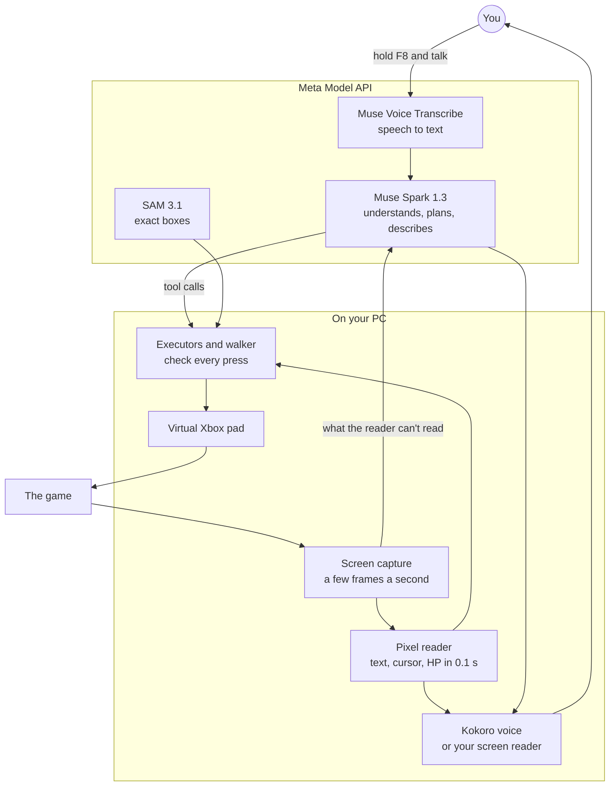

# Player Two

**An AI co-op partner for blind and low-vision gamers, and for players who can't easily hold a
controller. It reads the game out loud, answers questions, and plays when you ask, all by voice.**

Built for the Meta Global AI Developer Hackathon, Indie Developer track. Everything in this repo
was written during the event; the first commit is from Oct 27, 2026.

## Why

Most games never get a screen reader. A few have one because a fan spent months writing a mod for
that one game. Everywhere else, a blind player needs a sighted friend on the couch to read the
screen and press the buttons.

In 2019 the RetroArch emulator added accessibility features for blind players. Its release post
said:

> "A blind person still cannot get Super mario into the castle in Super Mario 64, nor defeat Lavos
> in Chrono Trigger ..."
>
> [RetroArch 1.8.2: Accessibility features for blind people](https://www.libretro.com/index.php/retroarch-1-8-2-coming-soon-accessibility-features-for-blind-people/),
> libretro, December 12, 2019

Player Two is meant to be that sighted friend, there whenever you want to play. It works on the
game as it is: no mods, and nothing the game's developer has to build. Chrono Trigger on Steam is
the game it's built and measured on.

## What it does

- **Reads the game as it happens:** dialogue word for word with who's speaking, the highlighted
  option in a menu or a Yes/No choice, whose turn it is, who's in danger.
- **Answers questions:** "Where am I?" "What's on the screen?" "What are we fighting?"
- **Gets you places:** "Take me to the fair." "Take me back outside." It knows the game's maps,
  so it walks the right way instead of wandering.
- **Does things for you:** "Buy three potions." "Crono, use Cyclone." "Win this fight for me."
  It says what it's doing, checks the result on screen, and says what happened, bad news included
  ("Cyclone went off, but Marle dropped to 1 HP").
- **Asks instead of guessing** when a request is unclear, and says so when it can't read
  something.
- **Speaks through your own screen reader** (Orca, NVDA) if you like, or in its own natural voice.
- **Hands-free mode** for players who can't easily press a key: it listens for "Player Two, ...".

## Demo video

> **VIDEO PLACEHOLDER.** The 3 minute demo (live Steam Chrono Trigger, every request spoken) goes
> here before Nov 4.

<!-- Replace the placeholder above with: [](video link) -->

## Measured on live Steam

Chrono Trigger on Steam, on my Linux desktop, nights of Oct 31 and Nov 1, both nights added
together, with Battle Mode set to Wait. Each request was sent to the running app as text, so
speech recognition isn't part of these numbers. Times are for the whole job; Player Two starts
speaking within 0.1 to 2 seconds of a request.

| Request | Passed | Time |
|---|---|---|
| "Where am I?" | 8/8 | 4 to 10 s |
| "What's on the screen?" (the demo save) | 7/7 | first words in about 2 s |
| "Take me to the fair", from the world map | 11/11 | 3 to 10 s, once 38 s |
| "Take me to the fair", from inside a shop or the inn | 4/4 | 20 to 36 s |
| "Take me back outside" | 13/14 | 4 to 29 s |
| "Buy three potions" | 3/3 | 28 to 48 s |
| "Rest at the inn" (after two fixes; the 3 tries before them failed) | 4/4 | 28 to 63 s |
| "What are we fighting?" | 9/9 | 3 to 6 s |
| "Attack the one on the left" | 10/11 | 7 to 10 s |
| "Crono, use Cyclone", when it was his turn (3 other times it said he wasn't ready, which was true) | 7/7 | 9 to 27 s |
| "Heal Marle" and the like, in a fight | 10/12 | 13 to 42 s |
| "Win this fight for me" | 14/14 | 10 to 155 s |
| "Run away" | 6/6 | 10 to 16 s |
| "Heal everyone up", outside a fight | 4/4 | 16 to 26 s |
| "Set the battle mode to Wait" | 8/8 | 8 to 12 s |
| "Talk to ..." someone, by name or description | 11/16 | 8 to 107 s |

What doesn't work well yet, from the same runs:

- A long trip to Guardia Castle took 2 to 4 minutes through forest fights.
- "Talk to ..." missed people described by position ("the shopkeeper on the left") and people
  walking around.
- Walking to a save point failed (0/1).
- On a save where Crono was alone, "What's on the screen?" said I was Marle (3/3).
- It lost all 3 tries against a boss.

Offline benches, on labelled frames from the Steam version and on the SNES version in an emulator:

| Narration of 163 labelled Steam frames | Muse Spark on every screen | Pixel reader first, Muse Spark for the rest |
|---|---|---|
| Must-say items said (text, highlighted option, who's in danger), average per frame | 92% | 100% |
| The same on 43 frames held out from the design | 88% | 100% |
| Median time to the first word | 1.45 s | 0.30 s |
| Cost per 1,000 screens | $11.14 | $2.70 |

Walking on the SNES version, judged by reading the game's memory: world-map trips passed 144/144
with the walker alone, and 48/52 and 50/54 with Muse Spark choosing the place from the request.
Trips inside towns and buildings passed 95/104 with the walker alone and 22/24 with the full agent.

## How it uses Meta's models

| Model | What it does |
|---|---|
| **Muse Spark 1.3** | The brain. Understands the spoken request and plans it with tool calls ("go to Leene Square", "buy 3 Potion at the item seller", "Crono: Cyclone"). Describes scenes, streaming into the voice sentence by sentence. In "win this fight for me" it picks the next command whenever something surprising happens, with the game paused while it thinks. Reads what the pixel reader can't, and finds people and things on screen for walking. |
| **Muse Spark 1.3, offline** | Builds a game's data once: read all 118 place labels on fan-made world-map images, named the people and exits in each surveyed room, turned a text walkthrough into a list of steps for "what do I do next?", and judged the live task runs. |
| **Muse Voice Transcribe** | Turns speech into text live, with the game's names as keywords. |
| **SAM 3.1** | Exact boxes. "Where is it?" answers with a short sound panned to where the thing is, and walking uses SAM's box when Muse Spark's is a sprite off. |
| **Muse Spark Open** | The same narrator and agent on open weights, through a hosted endpoint (Baseten or Modal); one setting switches. Both brains got 8/8 on a test battle scene and 20/22 on Persona 4 Golden narration checks. Meta's API is the default because it's faster: a median 1.4 s per narration line against 5.3 s. |

Meta has no text-to-speech model, so the voice is [Kokoro](https://github.com/hexgrad/kokoro),
running on your PC.

## How it works



1. The game window is captured a few times a second, and a new screen is noticed once it settles.
2. The pixel reader (Chrono Trigger on Steam so far) reads the game's own font, cursor, menus and
   HP in about a tenth of a second. What it can't read goes to Muse Spark.
3. You hold a key and talk, or say "Player Two, ..." hands-free. Muse Voice Transcribe turns it
   into text, and Player Two repeats it back in your words at once, so a misheard request is
   caught before anything happens.
4. Muse Spark plans the request with tools: press buttons, walk somewhere, talk to someone, fight,
   shop, or ask you a question.
5. Code on the PC carries it out on a virtual Xbox controller (uinput on Linux, ViGEm on
   Windows), checks every press against the reader, and reads the result: HP before and after,
   gold before and after.

**Why split it this way.** A blind player can't glance at the screen to check what the AI did. A
wrong HP number, a misread menu item or a press on the wrong option is worse than silence, and a
model call before every button press makes a game unplayable. So the model decides, and local
code does the parts that must be exact and fast. Walking works the same way: the maps were
surveyed once in an emulator, the player is found on them by image matching, and the route is
planned with A*, because vision models are bad at maps (Muse Spark took a village for the castle
and put the fair west of town when it's north).

Every part is described in [docs/how-it-works.md](docs/how-it-works.md).

## Quick start

You need:

- Windows 10 or 11, or Linux.
  - Windows: run the game windowed or borderless. Exclusive fullscreen can capture as black.
  - Linux: Hyprland (Omarchy), where it captures just the game window, or an X11 session, where
    it captures the whole first screen. GNOME and KDE on Wayland can't be captured yet; Player Two
    says so if the picture comes back black.
  - Linux also needs `git`, [uv](https://docs.astral.sh/uv/), a C compiler with kernel headers
    (for the virtual controller), PortAudio (`libportaudio2` on Debian and Ubuntu, `portaudio` on
    Arch and Fedora), and `gdbus` for screen reader output.
- A Meta Model API key from [Meta's developer site](https://dev.meta.ai), with billing set up.
  A described screen costs between a quarter of a cent and a cent in my tests.
- Speakers or a headset. A headset is best for hands-free.
- A graphics card is optional: the voice runs on the processor too.

On Windows, paste this into PowerShell. It installs everything, including the virtual controller
driver (Windows asks for permission once), then starts setup:

```powershell
irm https://raw.githubusercontent.com/btsouth/player-two/main/install.ps1 | iex
```

On Linux:

```bash
git clone https://github.com/btsouth/player-two && cd player-two
uv tool install --python 3.12 . --excludes uv-excludes.txt
player-two setup
```

The `--python 3.12` matters: uv otherwise picks the newest Python, and onnxruntime has no build
for Python 3.15 yet. With an NVIDIA card, install `".[cuda]"` in place of `.` to run the voice on
it (about 2 GB more; each line starts about half a second sooner).

Setup asks one question at a time: your key, screen reader, language, how much it says,
microphone, controller, hands-free, talk key and app launcher. Then start your game and run
`player-two`, or pick **Player Two** in your app launcher. It finds the game window by itself,
says hello, and starts narrating. Hold **F8** and talk. Setup adds that key on Omarchy and
Hyprland (on GNOME, as press to start and press again to stop), and Player Two takes it itself on
Windows; elsewhere, bind `player-two ctl talk` to a key
(press to talk, press again to stop), or turn on hands-free. Say "help" to hear what you can say,
and "what's wrong?" if something doesn't work.

## What you can say

In Chrono Trigger on Steam, everything in the [results table](#measured-on-live-steam). In any
game:

| Say | What happens |
|---|---|
| anything about the game | Player Two looks and answers, or does it |
| "Player Two, ..." (hands-free) | the same, with no key |
| "what's on the screen?" / "look around" | a spoken tour: what it's like, who and what is around you, the ways out |
| "what does it look like?" / "what's the mood?" | a few sentences on the setting, light, colours and mood |
| "where is the door?" | where it is from your character, with a short sound from that side |
| "take me to the stairs" / "go talk to her" | walks your character there (2D games) |
| "next" | presses A and reads the next line, without waiting for the model |
| "repeat" | says the last line again |
| "stop" / "cancel that" | stops talking, and stops a running command |
| "slower" / "faster" | its speaking speed |
| "terse" / "more detail" / "back to normal" | how much it says |
| "team up" | leaves menus to the game's own narrator, for games that have one |
| "watch my health" | sounds when health or stamina bars get low |
| "pause narration" / "resume narration" | stops and restarts narration ("pause" alone pauses the game) |
| "what's wrong?" | what it can and can't reach (game, controller, microphone, talk key) and the last problem |
| "help" / "goodbye" | what you can say / quit |

## Accessibility

- **No step needs sight.** Setup is plain questions and answers, one line each with the default in
  brackets, so it reads well in a screen reader. Problems (no key, no microphone, no controller,
  no network) are spoken with how to fix them, not printed.
- **Your screen reader, your settings.** With `output = "screen-reader"`, its words go to Orca
  (and on to a braille display) or speech-dispatcher on Linux, or to NVDA or JAWS on Windows, at
  the voice and speed you already use. Tested with Orca 51, speech-dispatcher and NVDA 2026.3.
  JAWS is not tested yet.
- **Catch mistakes early.** Every request gets an instant spoken echo in your words. It asks
  before anything that matters, and says so when it can't read something.
- **Fits how you play.** Terse mode for fast screen reader users, adjustable speed, and narration
  in English, Spanish, French, Italian, Portuguese or Hindi (it translates on-screen text).
- **Without a controller.** Hands-free mode listens all the time and acts only on what starts with
  "Player Two". The talk key can also be a press to start and another to stop.
- **Low vision.** An optional companion window shows what it sees, says and presses, with large
  captions and a box to type to it.
- **Who has tested it:** only me. I'm very nearsighted, not blind, and no blind player has used it
  yet. Sessions with blind players are the next step.

## Limits

- The deep Chrono Trigger support (the pixel reader, the battle, shop and menu executors, the
  surveyed maps) is work for each game. Other games get the general features: narration,
  questions, button presses, and walking to what's on screen in 2D games.
- Turn-based and menu games only. It doesn't play action games for you (it can warn about low
  health), and it gets lost in 3D dungeons.
- Chrono Trigger needs Battle Mode set to Wait; in Active mode its commands land too late. Start
  the game on the monitor it will stay on: a game moved to another monitor can draw at a slightly
  different scale, and map positions come out wrong.
- The Chrono Trigger work was tested on Linux (Hyprland) only. Windows was tested on a clean
  Windows 11 virtual machine (install, controller, NVDA, a live session), not with Chrono Trigger.
- Hands-free is tested only with generated voice clips, not a real voice in a real room. Over
  speakers, words said over its longer lines can get lost.
- Asking before saving, loading or a story choice is an instruction to the model, not a block in
  code, so back up saves you care about.
- Single-player only: virtual controllers can trip anti-cheat in online games.
- On Windows the virtual controller needs ViGEmBus, which its maintainer has retired. It still
  installs and works, and Player Two falls back to keyboard input without it.

## Game data

What Player Two knows about a game lives in `~/.config/player-two/`, not in this repo:

- `games/<game>.txt`: notes it writes itself ("the menu opens with Y"), read every session.
- `games/<game>.pack.txt`: how the game works (its menus, tech and item names), written once.
- `guides/<game>.txt`: a text walkthrough you supply, for "what do I do next?".
- `atlas/<game>/`: the game's maps. World maps are fan-made map images labelled with Muse Spark
  (`scripts/label_atlas.py`) and checked by a person. Rooms and towns are surveyed by walking them
  in an emulator with the game's memory as ground truth (`scripts/survey.py`,
  `scripts/survey_rooms.py`). They contain game art, so they aren't shared here.

Without these, Player Two still narrates, answers and plays, and walks to what it can see; finding
a place it hasn't seen yet is slow.

**`src/playertwo/data/ct_steam/`** is the one piece of Chrono Trigger data in the repo, about
100 KB. It's what the pixel reader reads with: 2,544 letter shapes from the game's font, each a
10 by 14 black and white bitmap stored as numbers with its letter, and two small cursor templates
(the pointing hand, and the bracket drawn round the fighter whose turn it is). They were cut from
frames of my own copy by `scripts/ct_glyph_learn.py`, from lines whose text I typed in by hand.
They're in the repo because the reader can't work without them, and because building them takes
someone who can see the screen to reach the right menus, fights and dialogue and type in what
they say. No maps, frames, saves or ROMs are in the repo.

## Settings

The settings button in the companion window changes the common ones while you play. All of them
live in `~/.config/player-two/config.toml`, or as flags on `player-two run`:

```toml
voice = "af_heart"        # Kokoro voice
speech_rate = 1.1
verbosity = "normal"      # terse, quiet, normal, detailed
language = "English"      # or British English, Spanish, French, Italian, Portuguese, Hindi
output = "auto"           # your screen reader when one is running, else the voice; or "voice", "screen-reader"
confirm = "important"     # always, important, never
team_up = false
window = ""               # part of the game window's title; empty means find the game
controls = "auto"         # gamepad, keyboard
companion = "auto"        # the window: auto (on Hyprland), on, off
hands_free = false        # listen all the time for "Player Two, ..."; no talk key needed
```

To run the narrator and agent on Muse Spark Open instead:

```toml
brain = "open"
open_base_url = "https://inference.baseten.co/v1"
open_model = "meta-models/muse-spark-open-1026"
# Baseten API key in ~/.config/player-two/open-api-key (or BASETEN_API_KEY).
# For a Modal shared endpoint, use its .modal.direct address and put the proxy token
# in ~/.config/player-two/modal.env as MODAL_PROXY_KEY=wk-... and MODAL_PROXY_SECRET=ws-...
```

SAM 3.1 and speech recognition stay on Meta Model API either way.

## Development

```bash
uv sync --python 3.12 --group dev
uv run pytest -q                  # unit tests, on recorded frames where they're available
uv run ruff check src tests scripts
uv run player-two narrate shot1.png shot2.png --wav out.wav
uv run player-two ask --dry-run --images shot.png -- "who is talking?"
```

Tests that need game frames, maps or recordings skip without them, since those are game art.
`player-two ctl do "take me to the fair"` sends a request to a running session as if you'd said
it, and `player-two run --log events.jsonl` keeps everything it heard and said.

The benches in `scripts/` need a copy of the game or frames from it, and the emulator ones an
isolated desktop (omabox, my own tool for that), so they don't run as is elsewhere:

- `emu_tasks.py`, `rooms_bench.py`, `atlas_walk.py`: the SNES version in RetroArch, each task
  judged by reading the game's memory.
- `narrator_bench.py`: narration of labelled Steam frames, scored for what had to be said, what
  was made up, and time to the first word.
- `play_tasks.py`: tasks on the Steam version, with Muse Spark judging the last screen.
- `arena_trials.sh`, `town_trials.sh`: scored runs against the test scenes in `tests/arena` (a
  small JRPG battle) and `tests/town` (a top-down town).
- `survey.py`, `survey_rooms.py`, `label_atlas.py`, `build_quests.py`, `atmos_rooms.py`: build a
  game's maps, room survey, walkthrough steps and place descriptions.
- `demo_record.sh`, `demo_captions.py`: record a monitor with sound, and turn the event log into
  subtitles.

## Credits

- Meta's [Muse Spark, Muse Voice Transcribe, SAM 3.1 and Muse Spark Open](https://dev.meta.ai).
- [Kokoro](https://github.com/hexgrad/kokoro) (voice, Apache 2.0 weights) through
  [kokoro-onnx](https://github.com/thewh1teagle/kokoro-onnx).
- [Silero VAD](https://github.com/snakers4/silero-vad) (speech detection for hands-free).
- [ViGEmBus](https://github.com/nefarius/ViGEmBus) and
  [vgamepad](https://github.com/yannbouteiller/vgamepad) (the controller on Windows),
  [python-evdev](https://github.com/gvalkov/python-evdev) (on Linux).
- NVDA's controller client and [accessible_output2](https://github.com/accessibleapps/accessible_output2)
  (screen readers on Windows), Orca and speech-dispatcher (on Linux).
- OpenCV, NumPy and Pillow for the image work.
- [RetroArch](https://www.retroarch.com) and the Snes9x core, for the emulator benches, and the
  libretro team's 2019 post quoted above.
- Chrono Trigger is © Square Enix. This project isn't affiliated with Square Enix.

## License

MIT. Kokoro's model weights are Apache 2.0.
