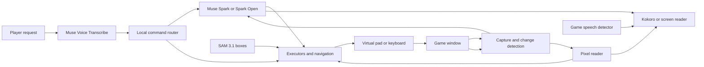

# Player Two

An AI co-op partner for blind, low-vision and motor-impaired gamers: it reads the screen,
answers questions and presses the buttons when you ask.

> **VIDEO PLACEHOLDER: final 3 minute demo goes here before submission.**

For players who need a sighted friend to read a menu, find a doorway or take a turn.
Say “take me to the fair”, “buy three potions” or “Crono, use Cyclone”. Player Two narrates,
acts through a virtual controller, checks the result and tells you what happened.

**No blind player has tested it yet.**

## Live results

Chrono Trigger on Steam, Nov 2, build `9c7c6f3`, Battle Mode set to Wait. Each run restarted the game
and loaded the same save. Requests were typed into the running app. The voice path has its own
tests: 63 of 63 synthetic spoken lines routed correctly, and real microphone runs come next. "Done" means the task finished correctly,
checked against the game's screen.

| Request | Done | Whole task |
|---|---:|---|
| Where am I? | 6/6 | 1.0 s |
| What's on the screen? | 6/6 | 21 to 28 s, first words about 1 s |
| Take me to the fair | 6/6 | 3.8 to 4.3 s, a door press from the world map |
| Buy three potions | 6/6 | 17.3 to 20.4 s |
| Take me back outside | 6/6 | 8.5 to 14.9 s |
| Crono, use Cyclone | 4/5 | 6.1 to 8.5 s when he was ready |
| Win this fight for me, after a combo took two or three of the party to 1 HP | 4/5 | Wins 42 to 53 s |

In the one lost fight the party was wiped out right after Cyclone was picked. Player Two then went
back through the title and loaded the last save without being asked. One more run didn't count
because my launch script failed before the fight started. Just before these runs, on a slightly
older build, a purchase wandered for 65 s by the seller and said nothing, so I made the walker give
up sooner. This is a small sample on one save, not a general success rate. Earlier
builds lost 3/3 boss attempts.

## Try it

A fresh install includes the generic narrator and agent, plus the Chrono Trigger pixel reader.

### Requirements

- Windows 10/11 or Linux; Python 3.12 is selected by the installer.
- A Meta Model API key with billing from [dev.meta.ai](https://dev.meta.ai) for live narration,
  questions and speech recognition. Open-weight mode also needs its provider's credentials.
- A supported capture session: Windows windowed/borderless, Linux Hyprland, or X11.
  GNOME/KDE Wayland capture is unsupported. X11 captures the first screen, not just the game.
- Microphone for voice commands, audio output or a supported screen reader. GPU optional.
- Linux: git, [uv](https://docs.astral.sh/uv/), C compiler and Linux kernel headers (evdev),
  PortAudio and gdbus. Ubuntu: `sudo apt install git build-essential linux-headers-generic libportaudio2 libglib2.0-bin`.
  Add `curl` if installing uv with its shell installer.

### Linux

```bash
git clone https://github.com/btsouth/player-two && cd player-two
uv tool install --python 3.12 . --excludes uv-excludes.txt
# If player-two is not found: run uv tool update-shell, then reopen the terminal.
player-two --help
player-two setup
```

Setup asks for the key, speech output, microphone, controller, hands-free/talk key and launcher.
It can explain missing devices on a headless machine, but a complete live session needs a desktop.
The controller permission step may request sudo; logging out and back in may be needed.
With NVIDIA, use `".[cuda]"` instead of `.` (roughly 2 GB extra dependencies).

### Windows

Paste into PowerShell:

```powershell
irm https://raw.githubusercontent.com/btsouth/player-two/main/install.ps1 | iex
```

The script installs uv, Python 3.12, the Windows extras, the Visual C++ runtime and, on x64,
ViGEmBus with one elevation prompt, then starts setup. It downloads **main**, so branch-only
fixes are not installed until merged. ViGEmBus is retired; if unavailable, keyboard control
is the fallback. ARM uses keyboard control. Use a windowed or borderless game.
Earlier Windows 11 VM testing covered installation and input; the deep Chrono Trigger path
has only been measured on Linux. This is not a fresh Windows acceptance result for every commit.

### No key or no desktop? Run the offline checks

After the Linux tool install, from the clone:

```bash
uv run --python 3.12 python scripts/self_check.py
```

This loads the packaged reader assets, processes a blank frame, and routes around a wall
with the real A* planner. No network calls, audio, controller or desktop are opened. It is
an install smoke check, **not an AI gameplay demo**. The first `uv run` may install the project dependencies; the check itself makes no network calls.

For a no-commercial-game demo on a supported desktop, open `tests/arena/index.html` in a browser
from this clone. It is a small local test battle: up/down choose, Enter confirms, Escape cancels.
With a key, run:

```bash
player-two run --controls keyboard --window Arena --game "a small JRPG test scene" --companion off
# In another terminal, while the Arena window is focused:
player-two ctl do "Read the dialogue"
```

Then try “attack the left enemy”. A Chromium browser on Hyprland can receive keyboard input;
other browser/session combinations are not guaranteed. `tests/town/index.html` supplies a
walking scene. These synthetic fixtures contain no commercial game footage. They work manually
without a key; Player Two's AI does not. Automated trials are in `scripts/arena_trials.sh` and
`scripts/town_trials.sh` and require an isolated desktop, credentials and extra tools.

### Play

Start your game, run `player-two`, hold F8 and speak. Setup binds the talk key on Hyprland and
Windows; elsewhere bind `player-two ctl talk` (toggle) or use hands-free. A headset reduces echo.
Say “stop” to cancel. Back up saves before allowing actions. Screen-reader output supports Orca,
speech-dispatcher and NVDA; JAWS is implemented but untested.

## How Meta models are used

| Model | Exact role and implementation |
|---|---|
| Muse Spark 1.3 | Scene narration streams to speech (`narrator.py`, `muse.py`); tool-calling plans in `agent.py`; visual grounding and fallback reads. Offline tools label maps/rooms and build walkthrough steps. The default Chrono Trigger fight loop uses local rules, not model-selected turns. |
| Muse Voice Transcribe | Live speech-to-text in `listen.py`, with game keywords. It is not the speaking voice. |
| SAM 3.1 | Segmentation/boxes for “where is it?” and optional walking target refinement (`locate.py`, `walk.py`). No-match falls back to Spark; it is not required for each press. |
| Muse Spark Open | `brain = "open"` switches narration and tool calls to a hosted OpenAI-compatible provider. A saved-frame narration on Baseten returned the visible result text in 6.0 s on Nov 1; this is not a new live agent benchmark. SAM and transcription remain on Meta's API. |

The voice is [Kokoro](https://github.com/hexgrad/kokoro), running locally. Silero VAD detects
speech. Open weights are hosted, not running on the player's PC. Baseten's published rates are
$1.25/M input, $0.15/M cached input and $4.25/M output tokens
([provider](https://www.baseten.co/library/muse-spark-open/)); the saved-frame call used
2,401 input and 294 output tokens, approximately $0.0043 before credits. This is an estimate,
not an invoice. A shorter 400-token JSON probe exhausted its budget and returned no usable content.

## Architecture



- **Pixel reader:** Chrono Trigger's font, cursor, turn and HP are read locally (`glyphread.py`,
  `ctsteam.py`, `ctscreen.py`). Ambiguous screens go to Spark. It is a per-game reader, not universal OCR.
- **Atlas navigation:** survey once, locate the view by image matching, route with A*, then check
  position as the character moves (`atlas.py`, `rooms.py`). Emulator RAM is survey/test ground truth;
  live Steam navigation uses pixels, not RAM. Private atlas images are not shipped.
- **Who decides:** common supported Chrono Trigger commands go straight to local executors
  (`fast.py`), with no model planning turn. “Win this fight” uses local attack/heal/revive rules:
  `battle.py` defaults `model_decides=False` and `agent.py` supplies no model decision callback.
  An optional model-decision path exists but is off by default. Muse handles scenes and
  open-ended requests through the tool loop; do not attribute default fight choices to it.
- **Checks after actions:** battle, shop and menu executors check highlights and before/after
  values. Generic press sequences force a new look before a confirm after another button.
  This is evidence checking, not a guarantee that every arbitrary action succeeds.
- **Game speech hold:** Linux game-audio VAD holds narration during detected speech
  (`gameaudio.py`). It has recorded-audio tests and one live Red Dead cutscene with no Player Two line.
  It is not available on Windows, and detection can miss speech.

[Implementation walkthrough](docs/how-it-works.md) explains the tools and failure handling.

## Limits and player control

**The recorded navigation/shop configuration cannot currently be reproduced from this repo alone.**
**It does not include the private maps, room surveys, game packs, walkthroughs or saves used
for the navigation results above.** You need your own game. See [game data](#game-data).

The strongest action support is Chrono Trigger in Wait mode. Deep support costs per-game work.
Generic descriptions and tools can fail on other games; action games and autonomous 3D traversal
are not supported. Moving the game between monitors can break image scale matching.

Hands-free has generated-voice tests, not player validation in a real room. Safety prompts for
saving, loading and story choices are model instructions, not an enforced transaction boundary.
Single-player only: virtual input can conflict with online anti-cheat. Screen frames and speech
are sent to model providers; local notes and event logs may contain game text or your requests.
No blind player has used this build. No outreach or user-benefit outcome is claimed.

## What you can say

In Chrono Trigger on Steam, see the measured results above. The generic interface offers
these commands, with behavior dependent on the game:

| Say | What happens |
|---|---|
| a question or request about the game | Player Two attempts to answer or act using the available tools |
| "Player Two, ..." (hands-free) | the same, with no key |
| "what's on the screen?" / "look around" | a spoken tour: what it's like, who and what is around you, the ways out |
| "what does it look like?" / "what's the mood?" | a few sentences on the setting, light, colours and mood |
| "where is the door?" | where it is from your character, with a short sound from that side |
| "take me to the stairs" / "go talk to her" | walks your character there (2D games) |
| "next" | presses A and reads the next line, without waiting for the model |
| "repeat" | says the last line again |
| "stop" / "cancel that" | stops talking, and stops a running command |
| "slower" / "faster" | its speaking speed |
| "terse" / "more detail" / "back to normal" | how much it says |
| "team up" | leaves menus to the game's own narrator, for games that have one |
| "watch my health" | sounds when health or stamina bars get low |
| "pause narration" / "resume narration" | stops and restarts narration ("pause" alone pauses the game) |
| "what's wrong?" | what it can and can't reach (game, controller, microphone, talk key) and the last problem |
| "help" / "goodbye" | what you can say / quit |

## Earlier validation and final recording status

Historical live Steam Chrono Trigger checks, Nov 1 afternoon, ending at `3b98a99`.
Requests were **typed**, not spoken. Times cover the whole task. These are small repeated
trials on selected saves, with private atlas data and Battle Mode set to Wait, not general
success rates. Newer code and the final voice recording need their own results.

| Request | Passed | Whole task | Limit |
|---|---:|---|---|
| Take me to the fair | 11/11 | 3 to 4 s | From the demo world-map position |
| Buy three potions | 11/11 | 17.6 to 63 s | Final three entrance-to-purchase runs: 18.6, 26.0, 26.7 s after map fixes |
| What are we fighting? | 3/3 | 1.9 to 3.2 s | Fight-start enemy count had separate errors |
| Crono, use Cyclone | 2/2 | 9.5 to 12.2 s | Only when Crono was ready |
| Win this fight for me | 3/4 | Wins 55 to 75 s | Lost when begun with two party members knocked out |
| Take me to the save point | 2/2 | 12.6 and 18.2 s | Walks there; does not save |

The same development runs lost 3/3 boss attempts, missed moving people and once spoke an
off-topic model answer. More recent guards have unit tests; that does not establish live reliability.

| Game in the film | What it shows | Result |
|---|---|---|
| Chrono Trigger (Steam) | Read, navigate, shop, fight | Table above. One recorded run also walks to Guardia Castle through a forest fight and back to the fair. |
| Monster Hunter Stories 3 | Read battle choices, take turns with a routine written for this game | Won 8/8 Somnacanth fights in recorded takes on Nov 2. I checked lines against frames: three takes had a false line about the next attack, since fixed, and none was found in the take used in the film. Muse reads the status and the weak points. |
| Red Dead Redemption | No code for this game, one line of notes. Describes a view, finds things, leaves dialogue alone | SAM 3.1 returned boxes on the requests in the film. A person walks John. Talking over actors on one recorded clip went from 12.7 s to 1.1 s with the speech hold. No Player Two line during 87 s of live cutscene. |

Final footage must show only behavior verified in that take. No claim of beating Lavos,
playing arbitrary games, or replacing a game's own accessibility features.

## Built during the event

**Built during the Oct 26 to Nov 4, 2026 event window.** This project starts at commit
`5a89075`, Oct 27, 2026 at 17:55 ET. The reader, agent, navigation, tools and tests in this
repository were built for the Meta Global AI Developer Hackathon, Indie track.
Dependencies and the commercial games themselves predate the event. MIT licensed code.
These are developer measurements, not accessibility validation.

## Game data

What Player Two knows about a game lives in `~/.config/player-two/`, not in this repo:

- `games/<game>.txt`: notes it writes itself ("the menu opens with Y"), read every session.
- `games/<game>.pack.txt`: how the game works (its menus, tech and item names), written once.
- `guides/<game>.txt`: a text walkthrough you supply, for "what do I do next?".
- `atlas/<game>/`: the game's maps. World maps are fan-made map images labelled with Muse Spark
  (`scripts/label_atlas.py`) and checked by a person. Rooms and towns are surveyed by walking them
  in an emulator with the game's memory as ground truth (`scripts/survey.py`,
  `scripts/survey_rooms.py`). They contain game art, so they aren't shared here.

Without these, a judge gets the generic narration/question interface, generic control tools,
the packaged pixel reader and synthetic test scenes. Named map trips, surveyed-room routes,
people matching and the demonstrated seller approach are not reproducible from a fresh clone.
Visual walking can attempt a visible target, with no equivalent map coverage or success claim.
[Game-data requirements and distribution limits](docs/game-data.md) explain what is missing.

**`src/playertwo/data/ct_steam/`** is the one piece of Chrono Trigger data in the repo, about
100 KB. It's what the pixel reader reads with: 2,544 letter shapes from the game's font, each a
10 by 14 black and white bitmap stored as numbers with its letter, and two small cursor templates
(the pointing hand, and the bracket drawn round the fighter whose turn it is). They were cut from
frames of my own copy by `scripts/ct_glyph_learn.py`, from lines whose text I typed in by hand.
They're in the repo because the reader can't work without them, and because building them takes
someone who can see the screen to reach the right menus, fights and dialogue and type in what
they say. No maps, frames, saves or ROMs are in the repo.

## Settings

The settings button in the companion window changes the common ones while you play. All of them
live in `~/.config/player-two/config.toml`, or as flags on `player-two run`:

```toml
voice = "af_heart"        # Kokoro voice
speech_rate = 1.1
verbosity = "normal"      # terse, quiet, normal, detailed
language = "English"      # or British English, Spanish, French, Italian, Portuguese, Hindi
output = "auto"           # your screen reader when one is running, else the voice; or "voice", "screen-reader"
confirm = "important"     # always, important, never
team_up = false
window = ""               # part of the game window's title; empty means find the game
controls = "auto"         # gamepad, keyboard
companion = "auto"        # the window: auto (on Hyprland), on, off
hands_free = false        # listen all the time for "Player Two, ..."; no talk key needed
```

To run the narrator and agent on Muse Spark Open instead:

```toml
brain = "open"
open_base_url = "https://inference.baseten.co/v1"
open_model = "meta-models/muse-spark-open-1026"
# Baseten API key in ~/.config/player-two/open-api-key (or BASETEN_API_KEY).
# For a Modal shared endpoint, use its .modal.direct address and put the proxy token
# in ~/.config/player-two/modal.env as MODAL_PROXY_KEY=wk-... and MODAL_PROXY_SECRET=ws-...
```

SAM 3.1 and speech recognition stay on Meta Model API either way.

## Development and evidence

```bash
uv sync --python 3.12 --group dev
uv run ruff check src tests scripts
uv run pytest -q
uv run python scripts/self_check.py
```

[Validation notes](docs/validation.md) record clean-install and model checks with their limits.
CI runs Linux lint/tests and Windows tests. Frame-dependent tests skip when private recordings
are absent; a green public run does not prove the full live-game claims. `tests/test_nav.py`
and the synthetic walker tests exercise geometry without a model or game. Bench tools under
`scripts/` separate model calls, deterministic execution and game-state ground truth.

## License

[MIT](LICENSE) applies to the project code. Dependencies and commercial game content retain
their own licenses. The small reader templates are derived from the game's font/cursors;
the code license does not grant rights to Square Enix's artwork. No ROMs, maps or saves ship here.
